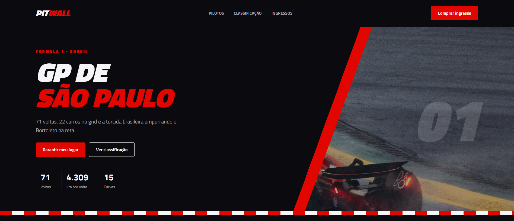

<h1 align="center">PITWALL — GP de São Paulo | A emoção de Interlagos</h1>

  <em>"A velocidade está na pista. A emoção está em cada curva."</em>

    

  
  
  
  

---

<h2>🏁 Sobre o Projeto</h2>

O <strong>PITWALL</strong> é uma página web inspirada no Grande Prêmio de São Paulo, realizado no Autódromo de Interlagos. O projeto apresenta uma interface temática de Fórmula 1, reunindo informações sobre pilotos, equipes, classificação e ingressos em um único ambiente.

A proposta é reproduzir a identidade visual de uma página de automobilismo, explorando elementos característicos das corridas, como cores das equipes, números dos pilotos, destaques da pista e a tradicional zebra das curvas.

Desenvolvido como atividade acadêmica da disciplina de <strong>Linguagem de Marcação (LIMA)</strong>, o projeto utiliza exclusivamente HTML5 e CSS3, colocando em prática conhecimentos de estruturação, estilização e desenvolvimento de interfaces responsivas.

## 📸 Prévia do Projeto

  
  <em>Interface do PITWALL — GP de São Paulo.</em>

---

<h2>🏎️ᯓ✦ Funcionalidades e Seções</h2>

A página foi organizada em diferentes áreas, cada uma responsável por apresentar uma parte da experiência do Grande Prêmio.

<table>
  <thead>
    <tr>
      <th>Seção</th>
      <th>Descrição</th>
    </tr>
  </thead>
  <tbody>
    <tr>
      <td>Destaque Principal</td>
      <td>Apresentação do GP de São Paulo, com informações sobre o circuito e opções de navegação.</td>
    </tr>
    <tr>
      <td>Grid de Pilotos</td>
      <td>Cards com identificação dos pilotos, números dos carros e respectivas equipes.</td>
    </tr>
    <tr>
      <td>Filtros</td>
      <td>Campos visuais para busca de pilotos e seleção de equipes.</td>
    </tr>
    <tr>
      <td>Classificação</td>
      <td>Tabela com posições, pilotos, equipes, vitórias, diferenças e pontuação.</td>
    </tr>
    <tr>
      <td>Ingressos</td>
      <td>Apresentação de três setores: Arquibancada A, Setor da Reta e Box VIP.</td>
    </tr>
    <tr>
      <td>Reserva</td>
      <td>Formulário com campos para dados pessoais, escolha de setor, quantidade e outras informações.</td>
    </tr>
  </tbody>
</table>

<h2>▸ Como a Página Funciona?</h2>

A navegação foi organizada para apresentar as principais informações do evento em uma sequência intuitiva:

<strong>01 — Destaque do GP</strong>

A página começa com a apresentação do Grande Prêmio de São Paulo, acompanhada de informações sobre voltas, extensão do circuito e quantidade de curvas.

<strong>02 — Grid de Pilotos</strong>

Os pilotos são apresentados em cartões individuais, identificados por seus números, nomes e equipes, cada uma representada por uma cor característica.

<strong>03 — Classificação</strong>

Uma tabela organiza as informações dos pilotos, incluindo posição, equipe, vitórias, diferença e pontuação. A seção também apresenta campos de pesquisa e seleção de equipes.

<strong>04 — Ingressos</strong>

São apresentados três setores com diferentes propostas de experiência: Arquibancada A, Setor da Reta e Box VIP, acompanhados de descrições e valores ilustrativos.

<strong>05 — Reserva</strong>

A última área apresenta um formulário para preenchimento de dados do visitante, escolha de setor, data, quantidade de ingressos, envio de fotografia e mensagem para o piloto.

<h2>✧ Tecnologias e Desenvolvimento</h2>

O projeto foi construído utilizando tecnologias fundamentais do desenvolvimento Front-end:

  

<ul>
  <li><strong>HTML5:</strong> responsável pela estruturação das páginas, organização dos conteúdos, navegação, formulários, campos de entrada e tabelas.</li>
  <li><strong>CSS3:</strong> utilizado na construção da identidade visual, estilização dos componentes, organização dos layouts, cores, espaçamentos e efeitos.</li>
</ul>

Durante o desenvolvimento, também foram aplicados os seguintes recursos:

<ul>
  <li><strong>Variáveis CSS (:root):</strong> centralização das cores e configurações visuais.</li>
  <li><strong>Flexbox:</strong> alinhamento do cabeçalho, destaque principal e filtros.</li>
  <li><strong>CSS Grid:</strong> organização dos cards de pilotos e formulário de ingressos.</li>
  <li><strong>Grid auto-fit:</strong> adaptação automática da distribuição dos cards.</li>
  <li><strong>Media Queries:</strong> ajustes de layout para diferentes resoluções de tela.</li>
  <li><strong>Google Fonts:</strong> utilização da família tipográfica Titillium Web.</li>
  <li><strong>Background Image:</strong> aplicação de fotografia na composição visual da página.</li>
  <li><strong>Gradientes CSS:</strong> criação de efeitos visuais, incluindo a zebra da pista.</li>
</ul>

<h2>▸ Estrutura do Projeto</h2>

Os arquivos foram organizados de maneira simples, separando a estrutura HTML, a estilização CSS e os recursos de imagem.

<pre>
PITWALL/
│
├── index.html
│
├── style.css
│
└── img/
    ├── F1.jpg
    └── previa-site.png
</pre>

<h2>▸ Escopo da Atividade</h2>

Esta entrega contempla exclusivamente o desenvolvimento do <strong>Front-end</strong>, responsável pela estrutura e apresentação visual da página.

Os elementos de navegação, filtros, formulários e classificação representam visualmente as funcionalidades de uma página de automobilismo. Não há integração com banco de dados ou processamento de reservas, e os dados apresentados são ilustrativos.

<h2>▸ Atividade Acadêmica</h2>

Atividade prática desenvolvida na disciplina de <strong>Linguagem de Marcação (LIMA)</strong>, no curso Técnico em Desenvolvimento de Sistemas do SENAI.

O desafio propõe a recriação de uma página inspirada no GP de São Paulo, em Interlagos, utilizando exclusivamente HTML e CSS.

A atividade tem como objetivo aplicar os conhecimentos adquiridos durante as aulas, explorando variáveis CSS, Flexbox, Grid Layout, formulários, tabelas, tipografia, imagens de fundo e responsividade para diferentes dispositivos.

<h2>▸ Autoria</h2>

  <strong>Desenvolvimento:</strong> Gabriel de Araujo Torres 
  <strong>Curso:</strong> Técnico em Desenvolvimento de Sistemas 
  <strong>Instituição:</strong> SENAI — A. Jacob Lafer 
  <strong>Disciplina:</strong> Linguagem de Marcação (LIMA)

---

  

  <h4>PITWALL</h4>

  <em>Velocidade, tecnologia e desenvolvimento em cada linha de código.</em>

    

  ---

  

  

    

  <code>HTML5</code> • <code>CSS3</code> • <code>Front-end</code> • <code>SENAI</code>

   

  <strong>PITWALL · Projeto de estudo de HTML e CSS · Feito por Gabriel de Araujo Torres</strong>

   

  © 2026 — Projeto acadêmico desenvolvido para fins educacionais.

   

  <strong>Obrigado por visitar!</strong>

